# LumaSearch

A production-grade, open-source, self-hostable next-generation search engine. **Fully self-contained** — pure Node.js +
SQLite. No Docker, no Redis, no Elasticsearch required.

## Quick Start

```bash
git clone https://github.com/singhtanishq/LumaSearch.git
cd LumaSearch
pnpm install
pnpm run db:generate && pnpm run db:push
pnpm run seed
pnpm dev
```

That's it. The server starts at `http://localhost:4000` with:

- **Search API** — `POST /api/v1/search` with BM25 ranking, field boosts, operators, facets
- **AI Answers** — `POST /api/v1/answer` with citations (optional, needs LLM key)
- **Crawler** — `POST /api/v1/crawl/jobs` with robots.txt, SSRF protection, dedup
- **Health checks** — `GET /health/ready`, `GET /health/live`
- **Prometheus metrics** — `GET /metrics`

## Architecture

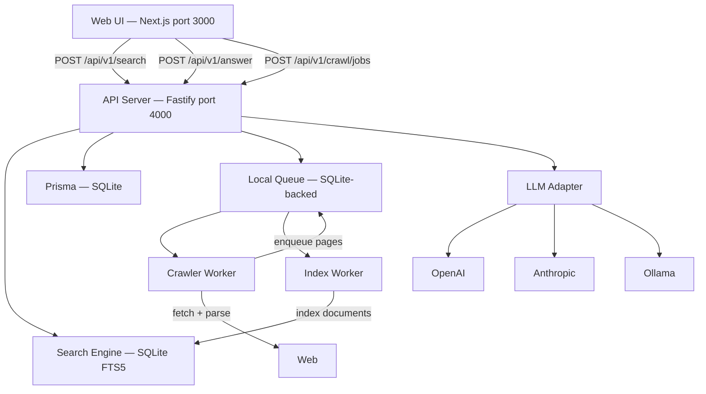

**Zero infrastructure** — everything runs in a single Node.js process backed by SQLite files in `./data/`.

| Component        | Technology               | Replaces       |
| ---------------- | ------------------------ | -------------- |
| Metadata DB      | SQLite + Prisma          | PostgreSQL     |
| Full-text search | SQLite FTS5 + BM25       | Elasticsearch  |
| Job queue        | SQLite-backed in-process | Redis + BullMQ |
| API server       | Fastify                  | —              |
| Crawlers         | In-process workers       | —              |

## Features in Detail

### Full-Text Search

LumaSearch uses SQLite FTS5 with BM25 scoring to rank results. Field-weighted retrieval boosts title matches above body
matches. Results include highlighted snippets with `<mark>` tags around matching terms.

**Supported search operators:**

| Operator             | Example             | Behavior                          |
| -------------------- | ------------------- | --------------------------------- |
| `site:`              | `site:github.com`   | Restrict to domain (suffix match) |
| `"phrase"`           | `"exact phrase"`    | Exact phrase match                |
| `-term`              | `-deprecated`       | Exclude term                      |
| `before:` / `after:` | `before:2024-01-01` | Date range                        |

**Ranking profiles:**

| Profile           | Behavior                                                |
| ----------------- | ------------------------------------------------------- |
| `hybrid`          | Balanced BM25 with fresh and authority boosts (default) |
| `fastest`         | Pure BM25, no freshness or authority adjustments        |
| `recent`          | Heavy freshness boost                                   |
| `primary-sources` | Boost .gov, .edu, wikipedia.org, arxiv.org              |
| `technical`       | Boost github.com, stackoverflow.com, MDN                |
| `documentation`   | Boost developer docs and reference sites                |
| `research`        | Maximize recall with moderate freshness                 |

### Web Crawler

The built-in crawler fetches web pages, extracts clean content (removing navigation, scripts, and boilerplate), and
indexes them into the search engine. It respects robots.txt, blocks private IP addresses (SSRF protection), enforces
per-host politeness delays, and detects crawl traps.

### AI Answers (Optional)

When configured with an LLM provider (OpenAI, Anthropic, or Ollama), LumaSearch generates evidence-backed answers with
inline citations. The system retrieves relevant passages, sanitizes them against prompt injection, and synthesizes an
answer with source links. When AI is disabled (the default), the Answer button returns a 503 response.

### Admin Dashboard

A separate Next.js app (`apps/admin`) provides real-time system health, crawl job monitoring, index statistics, and
queue depth metrics.

---

## Visual Documentation

Every screenshot below was captured from the running local application at `http://localhost:3000`.

### 1. Homepage — Desktop (1440×900)

The primary search interface at full desktop width. The header contains the LumaSearch logo, a ranking-profile dropdown
set to "Hybrid (BM25 + Vector)", and a blue Answer button. The large search input is focused with a blue border,
displaying the placeholder text with keyboard shortcut hints. Below, the empty state guides new users with example
search operators and keyboard shortcuts.


### 2. Homepage — Laptop (1280×800)

The same homepage rendered at a compact laptop viewport. The layout adapts seamlessly — the search input remains
centered and fully interactive, all controls stay within reach, and no content is clipped or overlapped.

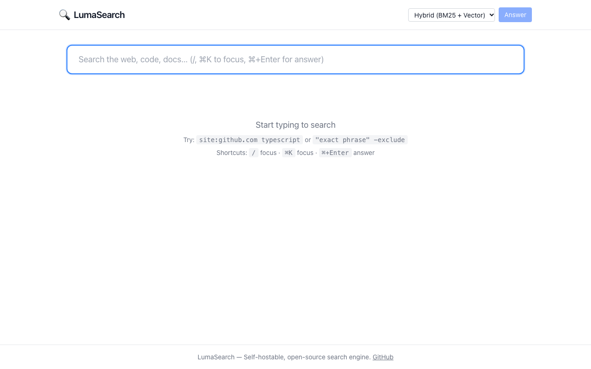

### 3. Homepage — Tablet (768×1024)

The homepage at tablet width. The single-column layout adapts naturally — the header controls remain in a single row,
the search input spans the available width, and the empty-state text wraps cleanly without horizontal overflow.

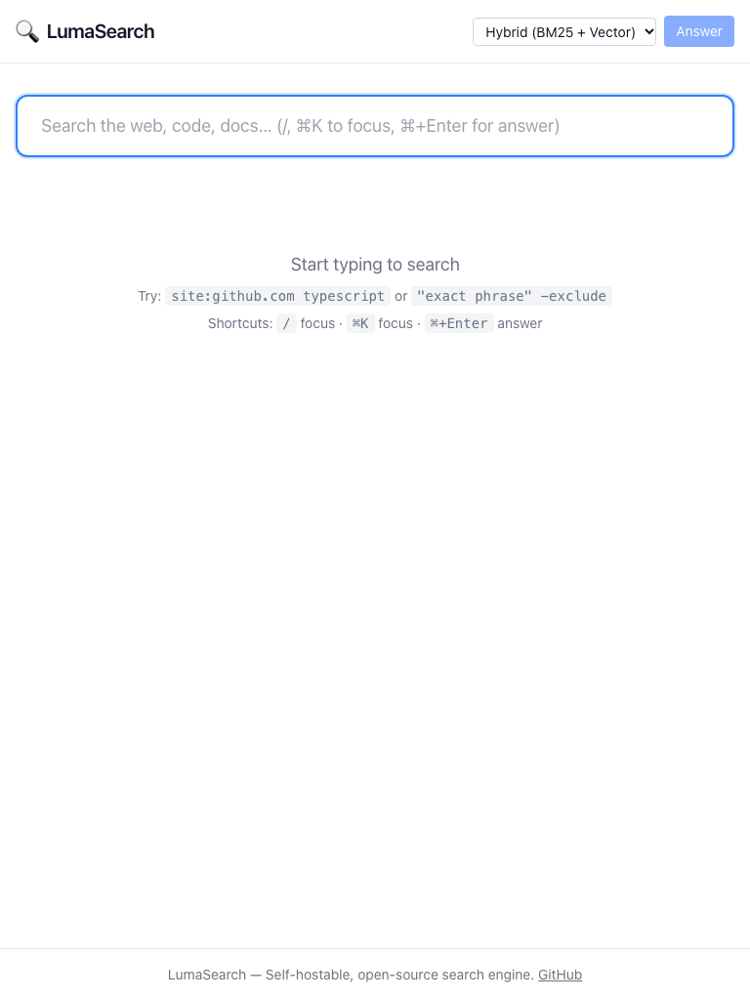

### 4. Homepage — Mobile (390×844)

The homepage at mobile width. The search input spans the full viewport width and the interface remains fully
functional. The header controls wrap to fit the narrow screen, demonstrating the responsive breakpoints.

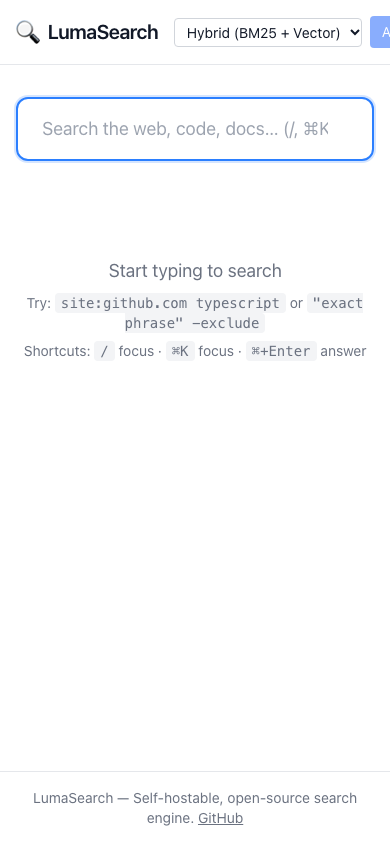

### 5. Search — Empty State

The default interface state before any search is submitted. The search input is empty and focused, with the
"Start typing to search" message, operator examples (`site:github.com typescript`, `"exact phrase" -exclude`), and
keyboard shortcut hints (`/` to focus, `⌘K` to focus, `⌘+Enter` for answer) displayed below.

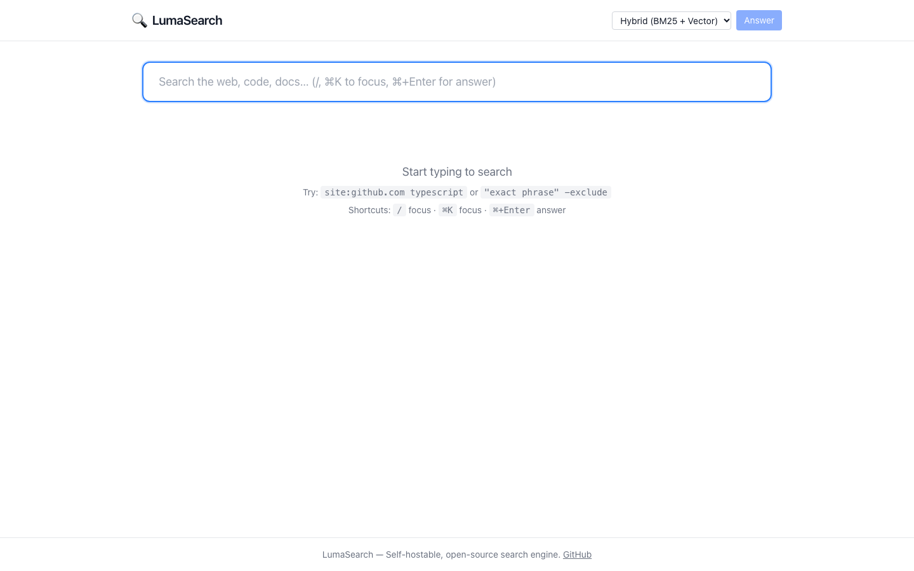

### 6. Search Results — "typescript"

Results for the query "typescript" completed in 9ms. A single result card is displayed for "TypeScript - GitHub" from
github.com, showing the content-type badge (`code`), the source tag (`local-index`), the publication date (2/1/2024),
the crawl date (10/28/2026), and a snippet with the matching term "TypeScript" highlighted in yellow.


### 7. Search with `site:` Operator

Results for "search site:wikipedia.org" completed in 1ms. Two results are returned, both from `en.wikipedia.org` —
the "Elasticsearch - Wikipedia" and "Web crawler - Wikipedia" articles. This demonstrates the `site:` operator's
suffix-matching domain filter, which correctly matches subdomains. The term "search" is highlighted in yellow within
each result's snippet.

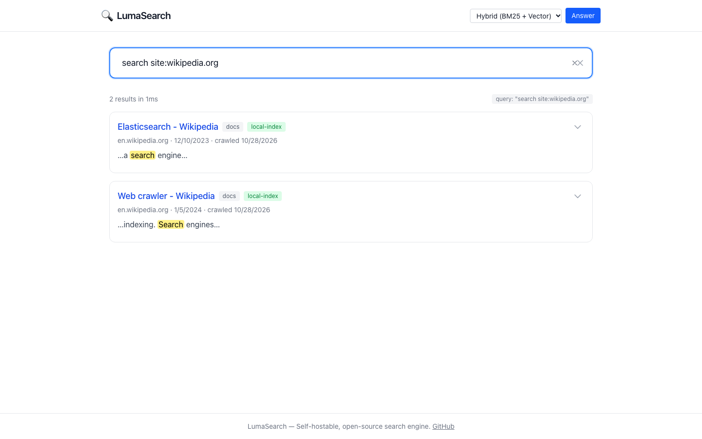

### 8. Search with Exclusion Operator

Results for "programming -python" completed in 2ms. Two results are returned — "JavaScript | MDN" from
developer.mozilla.org and "TypeScript - GitHub" from github.com — with the word "programming" highlighted in yellow.
The Python-related result is correctly excluded from the result set, demonstrating the `-` exclusion operator.

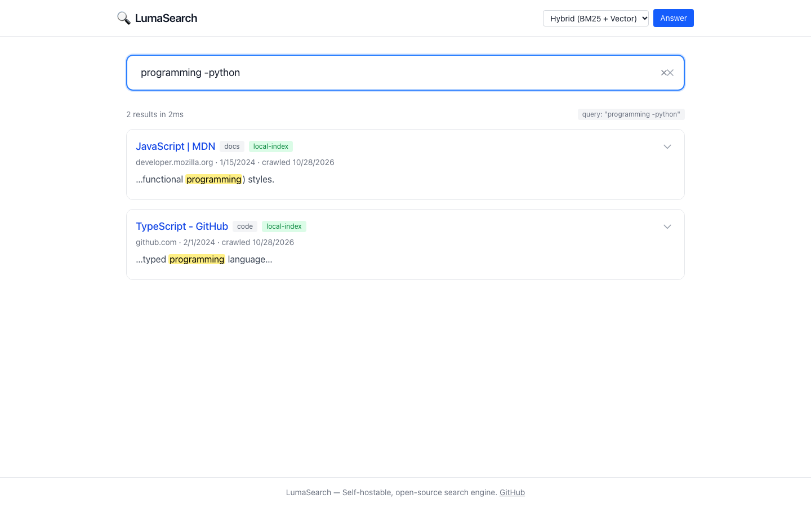

### 9. Search with "Fastest" Ranking Profile

Results for "javascript" after switching the ranking profile to "Fastest (BM25 only)" via the header dropdown.
Four results are returned in 1ms — React, Node.js Documentation, JavaScript | MDN, and TypeScript - GitHub — each
with the term "JavaScript" highlighted. The profile selector in the header now reads "Fastest (BM25 only)".

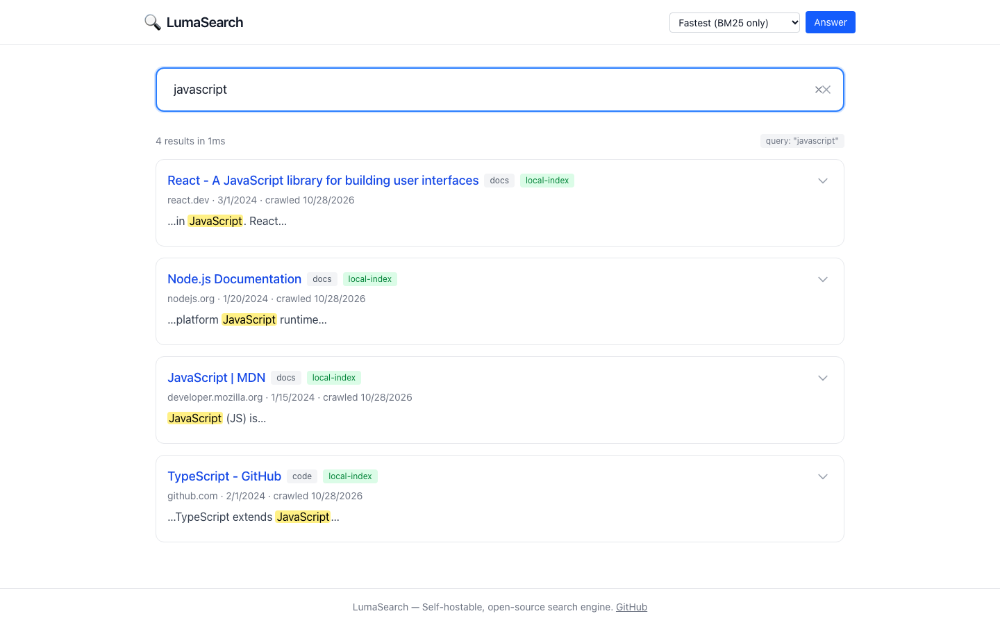

### 10. Search — No Results

The interface when a query returns zero results. The search input contains the query "zzzznonexistent12345" but no
result cards, result count, or query badge are rendered. The page degrades gracefully to show only the search bar
and footer.

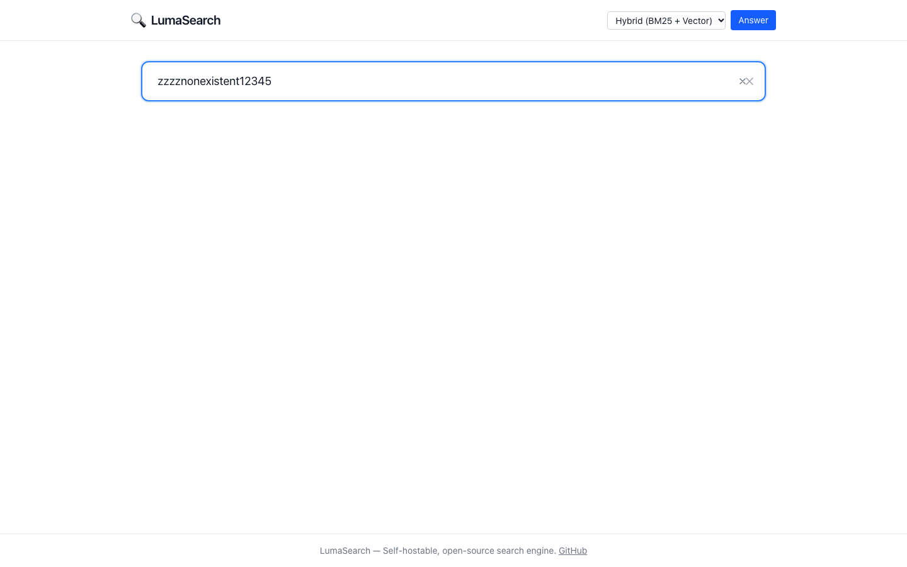

### 11. Result Card Layout

A close-up view of the result card structure for the "typescript" query. Each card displays the result title as a
clickable blue link, a content-type badge (`code`), a source-origin tag (`local-index`), the source domain
(github.com), the publication date, the crawl date, and a snippet with the matching search term highlighted.

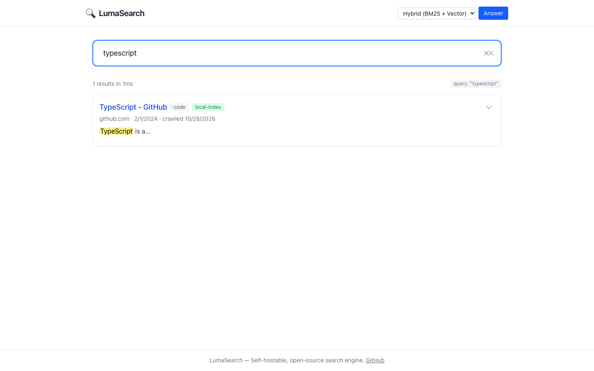

### 12. Expanded Result Metadata

The result card with its metadata panel expanded via the chevron toggle. This view reveals internal document details
including the document identifier (`doc_seed_2`), the detected language (`en`), and the BM25 relevance score (`3.002`).
This screenshot was captured during the initial testing pass before the Tailwind CSS fix was applied, so it shows the
unstyled HTML rendering of the expanded metadata.


### 13. Search Results — Laptop (1280×800)

Search results for "typescript" rendered at the laptop viewport. The layout is identical to desktop with the search
input, result count, and result card fitting comfortably within the narrower frame.

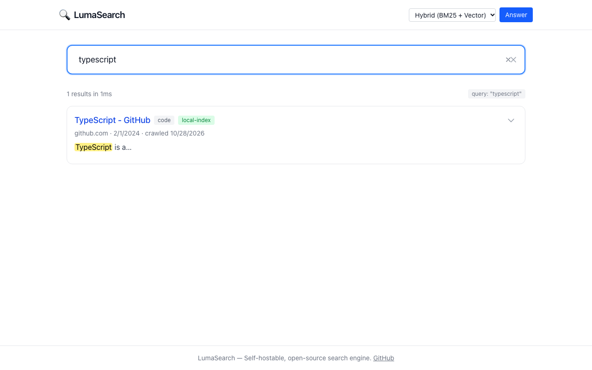

### 14. Search Results — Tablet (768×1024)

Search results at tablet width. The result card and search input adapt to the single-column layout without any
horizontal overflow. The profile selector and Answer button remain accessible in the header.

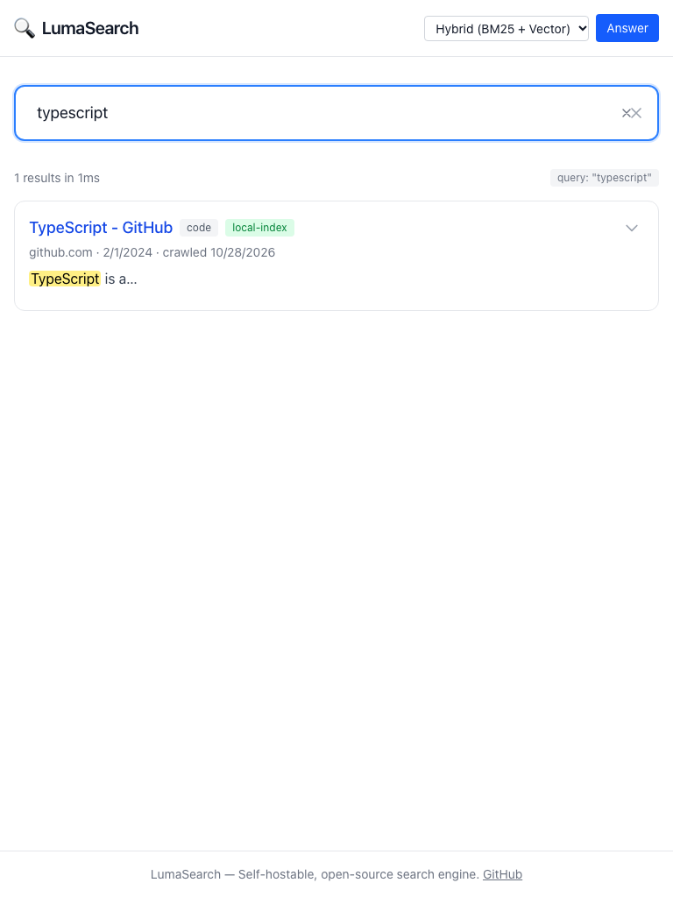

### 15. Search Results — Mobile (390×844)

Search results at mobile width. The result card title truncates gracefully ("TypeScript -…"), the content-type and
source badges wrap to a second line, and the highlighted snippet remains readable. The layout demonstrates
touch-friendly target sizes on the narrow screen.

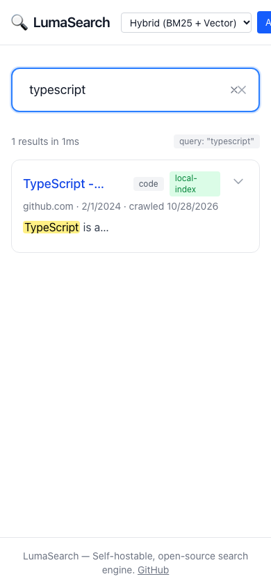

---

## API Usage

```bash
# Search
curl -X POST http://localhost:4000/api/v1/search \
  -H "Content-Type: application/json" \
  -d '{"q": "typescript", "profile": "hybrid", "limit": 10}'

# AI Answer (requires LLM_PROVIDER in .env)
curl -X POST http://localhost:4000/api/v1/answer \
  -H "Content-Type: application/json" \
  -d '{"q": "What is TypeScript?"}'

# Submit crawl job
curl -X POST http://localhost:4000/api/v1/crawl/jobs \
  -H "Content-Type: application/json" \
  -d '{"seeds": ["https://example.com"], "maxPages": 100, "maxDepth": 2}'

# More like this
curl http://localhost:4000/api/v1/documents/<docId>/similar?limit=5
```

## Application Routes

### API Server (port 4000)

| Endpoint                        | Method | Purpose                  |
| ------------------------------- | ------ | ------------------------ |
| `/api/v1/search`                | POST   | Full-text search         |
| `/api/v1/answer`                | POST   | AI answer with citations |
| `/api/v1/crawl/jobs`            | POST   | Submit crawl job         |
| `/api/v1/crawl/jobs`            | GET    | List crawl jobs          |
| `/api/v1/crawl/jobs/:id`        | GET    | Crawl job details        |
| `/api/v1/index/status`          | GET    | Search engine statistics |
| `/api/v1/documents/:id/similar` | GET    | Find similar documents   |
| `/api/v1/queue/stats`           | GET    | Queue depth statistics   |
| `/health/live`                  | GET    | Liveness probe           |
| `/health/ready`                 | GET    | Readiness probe          |
| `/metrics`                      | GET    | Prometheus metrics       |

## Technology Stack

| Layer              | Technology                       | Role                       |
| ------------------ | -------------------------------- | -------------------------- |
| Runtime            | Node.js 20+                      | JavaScript runtime         |
| Package manager    | pnpm 9                           | Workspace management       |
| Build orchestrator | Turborepo                        | Monorepo task running      |
| API framework      | Fastify 4                        | HTTP server                |
| Search engine      | SQLite FTS5                      | Full-text search with BM25 |
| Database           | SQLite + Prisma 5                | Metadata and state         |
| Web UI             | Next.js 14 + React 18            | Search interface           |
| Styling            | Tailwind CSS 4                   | Utility-first CSS          |
| Crawler            | Custom (linkedom, robots-parser) | HTML parsing and fetching  |
| AI/LLM             | Adapter pattern                  | OpenAI, Anthropic, Ollama  |
| Logging            | Pino                             | Structured JSON logging    |
| Metrics            | prom-client                      | Prometheus metrics         |
| Testing            | Vitest + Playwright              | Unit and browser testing   |
| Type checking      | TypeScript 5                     | Static type checking       |

## Project Structure

```
luma-search/
├── apps/
│   ├── server/              # Self-contained API + worker server
│   │   └── src/
│   │       ├── server.ts        # Fastify API + queue workers
│   │       └── seed.ts          # Demo corpus seeding
│   ├── web/                 # Next.js search UI
│   │   └── src/app/
│   │           ├── page.tsx         # Main search page
│   │           ├── SearchResults.tsx
│   │           ├── AnswerPanel.tsx
│   │           └── layout.tsx
│   └── admin/               # Admin dashboard
├── packages/
│   ├── search-engine/       # SQLite FTS5 search engine
│   ├── queue/               # SQLite-backed job queue
│   ├── storage/             # Prisma + SQLite client
│   ├── crawler-core/        # Fetcher, parser, SSRF, traps
│   ├── query/               # Query parsing and intent detection
│   ├── evidence/            # AI answer synthesis
│   ├── llm/                 # LLM provider adapters
│   ├── embeddings/          # Embedding provider adapters
│   ├── config/              # Zod environment validation
│   ├── telemetry/           # Pino logging, Prometheus
│   ├── utils/               # URL, hash, text utilities
│   └── types/               # Shared TypeScript types
├── docs/
│   ├── screenshots/         # UI screenshots
│   ├── screenshot-index.md
│   ├── test-coverage.md
│   ├── ui-audit.md
│   └── ...
├── scripts/
│   └── browser-test.mjs     # Playwright browser tests
└── turbo.json
```

## Configuration

Copy `.env.example` to `.env` and customize. All variables have working defaults.

| Variable                     | Default               | Required | Description       |
| ---------------------------- | --------------------- | -------- | ----------------- |
| `DATABASE_URL`               | `file:./data/luma.db` | No       | SQLite path       |
| `LUMA_DATA_DIR`              | `./data`              | No       | Data directory    |
| `API_PORT`                   | `4000`                | No       | API server port   |
| `LLM_PROVIDER`               | `disabled`            | No       | AI provider       |
| `OPENAI_API_KEY`             | —                     | For AI   | OpenAI key        |
| `ANTHROPIC_API_KEY`          | —                     | For AI   | Anthropic key     |
| `CRAWLER_RESPECT_ROBOTS_TXT` | `true`                | No       | Obey robots.txt   |
| `CRAWLER_BLOCK_PRIVATE_IPS`  | `true`                | No       | SSRF protection   |
| `LOG_LEVEL`                  | `info`                | No       | Logging verbosity |

[Full configuration reference](docs/configuration.md)

## User Workflows

### Searching

1. Open `http://localhost:3000`.
2. Type a query and press Enter (or press `/` to focus).
3. Results appear with BM25 ranking and highlighted terms.
4. Switch ranking profiles via the dropdown.
5. Use operators (`site:`, `"phrase"`, `-exclude`) for advanced queries.

### Crawling

1. Submit a crawl job via the API with seed URLs.
2. The crawler fetches, parses, and indexes pages.
3. Search the indexed content immediately.
4. Monitor progress via the API or admin dashboard.

### AI Answers (Optional)

1. Set `LLM_PROVIDER` and API key in `.env`.
2. Restart the server.
3. Type a question and click Answer (or press `⌘+Enter`).
4. View the answer with inline citations.

## Testing and Quality Checks

| Check                         | Result                      |
| ----------------------------- | --------------------------- |
| TypeScript type checking      | ✅ 0 errors (16 packages)   |
| ESLint                        | ✅ 0 errors (16 packages)   |
| Unit tests (Vitest)           | ✅ 33 passed                |
| Prettier formatting           | ✅ 0 warnings               |
| Production build              | ✅ 16/16 successful         |
| Browser tests (Playwright)    | ✅ 22 scenarios, 0 failures |
| Console errors during testing | ✅ 0                        |

- [Test coverage report](docs/test-coverage.md)
- [UI audit report](docs/ui-audit.md)
- [Screenshot index](docs/screenshot-index.md)

## Known Limitations

1. **AI Answers require configuration** — Without an LLM provider key, the Answer button returns a 503 error that is not
   gracefully handled in the UI.
2. **No dedicated crawl UI** — Crawl jobs are managed via the API. The admin dashboard has a monitoring tab but no
   submission form.
3. **Single-process architecture** — The server runs the API and all workers in one process. For high-traffic
   deployments, scale by running multiple instances behind a load balancer.
4. **SQLite write concurrency** — SQLite uses WAL mode for concurrent reads but writes are serialized. For very high
   write throughput, consider switching to PostgreSQL.
5. **Vector search not active** — The hybrid profile supports BM25 + vector fusion, but vector embeddings require
   configuring an embedding provider. Without one, only BM25 lexical search is active.

## Development

```bash
pnpm dev          # Start API server with hot-reload
pnpm test         # Run all tests
pnpm lint         # Lint all packages
pnpm typecheck    # Typecheck all packages
pnpm build        # Build all packages
pnpm format:check # Check formatting
```

## License

MIT
